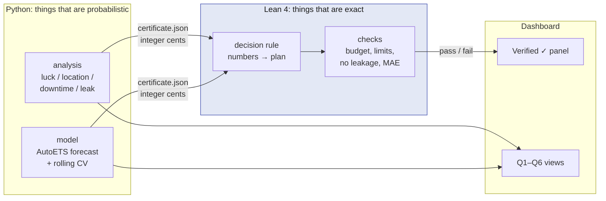
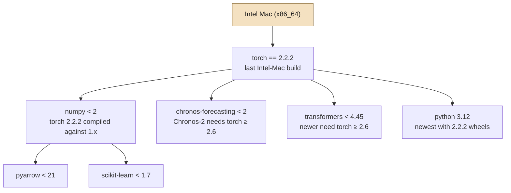

# Decisions Log

Every non-obvious choice we've made, with the reasoning, so a teammate (or a judge reading our appendix) can see *why* and not just *what*. Newest at the bottom. Open questions live in [`IDEAS.md`](IDEAS.md).

---

## D1 · Work in a fork of the organizers' repository

**Date:** 2026-11-07

**Decision:** Our repo is `alemanb/dashboard-royale`, a GitHub fork of `tamu-datathon-org/dashboard-royale`, with `upstream` pointing at the original.

**Why:** The data release is `0.9.0-draft`; the organizers say values may change before `1.0.0`. A fork lets us `git pull upstream main` to pick up corrected data without re-downloading 490 MB or re-wiring anything.

**Consequence:** The fork is public (GitHub forks of public repos can't be private). Submission requires public code anyway.

---

## D2 · Analysis in Python + DuckDB, querying Parquet directly

**Date:** 2026-11-07

**Decision:** Analysis scripts live in `analysis/`, use DuckDB SQL against the `.parquet` files, and convert to pandas only for the final small result.

**Why:** The large tables (`machine_hour` 1.3M rows, `sessions` and `loyalty_ledger` ~780K) would be slow or impossible to load whole in pandas or a BI tool. DuckDB reads Parquet lazily and aggregates in-engine; the guide recommends exactly this. Parquet is typed (no cents-vs-dollars ambiguity from CSV parsing).

---

## D3 · Architecture: predict → decide → verify

**Date:** 2026-11-07

**Decision:** Three layers, each in the tool suited to it.



| Layer | Tool | Responsibility |
|---|---|---|
| Analysis | Python + DuckDB | Luck / location / downtime / leak tests; per-machine adjusted metrics; statistical claims with uncertainty |
| Model | Python (statsforecast, scikit-learn) | Forecast daily floor coin-in on a time-based split; compare with a simple baseline |
| Decision + verification | Lean 4 | Turn the numbers into the $100K plan under explicit rules, and prove the plan obeys them |

**Why:** Statistical claims ("machine X was unlucky") are probabilistic and belong in Python with uncertainty shown. Rules ("≤ $100,000", "≤ 3 action types", "training dates precede test dates") are exact and belong in a checker that cannot be argued with.

**What we deliberately do not do:** run the ML in Lean (no data tooling; would consume the whole event) or try to prove statistical claims in Lean (not provable; they hold with some probability).

---

## D4 · Lean 4 core, without Mathlib, as an *output checker*

**Date:** 2026-11-07

**Decision:** A Lake executable (`lake exe verify certificate.json`) reads a JSON certificate exported by Python, with every money amount in **integer cents**, and checks it. Only core Lean; no Mathlib dependency.

```mermaid
sequenceDiagram
    participant Py as Python (analysis + model)
    participant J as certificate.json
    participant L as Lean checker (lake exe verify)
    participant D as Dashboard
    Py->>J: write plan, ranking, folds, MAE<br/>all money as integer cents
    Py->>L: subprocess.run(["lake", "exe", "verify", "certificate.json"])
    L->>J: parse with Lean.Json
    L->>L: recompute costs, sums, sort order, date comparisons
    alt every rule holds
        L-->>Py: exit 0, "VERIFIED"
        Py->>D: show Verified ✓ with each check listed
    else any rule fails
        L-->>Py: exit 1, names the failing rule
        Py->>D: show the failure; plan is not publishable
    end
```

The checker never trusts a Python total: it re-adds the cents itself. If Python and Lean disagree, Lean wins and the dashboard says so.

**What it checks (planned):**
- Budget plan: total cost ≤ 10,000,000 cents; ≤ 3 action types; each quantity ≤ its `quantity_limit`; no conflicting actions on the same machine; comp pilot not combined with the floor-wide comp change. Cost formula `qty × (unit_cents + daily_cents × (30 − lead_days))` with `Nat` subtraction giving the guide's `max(0, ·)` for free.
- Model validation: every training date < every test date in every fold; every feature's `announced_date` < the forecast origin (no leakage); MAE recomputed exactly and matching the dashboard's number.
- Ranking certificate: the published bottom-10 list is sorted by the stated metric and each value matches its formula.

**Why core Lean and not Mathlib:**

| | Core Lean | Lean + Mathlib |
|---|---|---|
| Computes on our actual numbers | Yes: `Nat`/`Int` cents are exact and `decide` evaluates | Mathlib's `ℝ` is non-computable; it exists for proofs, not for checking data |
| Install footprint | ~1 GB toolchain (already installed via `elan`) | Several additional GB of download + build; the dev machine has ~5 GB free |
| What it proves | "*This* plan, with *these* numbers, follows every rule" | General theorems (e.g. Chebyshev's inequality justifying a z-threshold) |

Ratios (hold, availability) are compared by cross-multiplication (`a·d < c·b`), so no division or real numbers are needed. Mathlib stays optional if we later want a general theorem for the write-up.

**Why `subprocess` and not LeanInteract:** LeanInteract drives the Lean REPL for interactive proving. We only need "run this checker on this file, read pass/fail," which `subprocess.run(["lake", "exe", "verify", ...])` does with no extra dependency.

**Scoring honesty:** Lean earns no rubric points by itself. It is a multiplier on the analysis (credibility for every number; a direct answer to the judges' "find how the model was validated" and "trace a recommendation to its evidence"). The 30% validity and 10% originality criteria are about the *statistics* and *findings*, which stay in Python.

---

## D5 · uv for the Python environment

**Date:** 2026-11-07

**Decision:** `pyproject.toml` declares dependencies; `uv sync` installs them; `uv.lock` is committed; scripts run via `uv run python analysis/<script>.py`. No ad-hoc `pip install`.

**Why:** The first setup used `python -m venv` + `pip`. Within an hour it drifted: a later `pip install scikit-learn<1.7` pulled a new SciPy, and pip upgraded NumPy to 2.x to satisfy it because that one command didn't restate the `numpy<2` constraint. Torch then failed at runtime. uv resolves the whole dependency set at once against one lockfile, so this cannot recur, and a teammate gets the identical environment.

**Hardware constraint that shapes the pins:** development is on an **Intel Mac (x86_64)**. PyTorch stopped publishing Intel-Mac wheels after **2.2.2**, and that build was compiled against NumPy 1.x. Everything downstream must stay NumPy-1 compatible. One hardware fact cascades into six pins:



What went wrong with pip: it resolves one command at a time. `pip install scikit-learn<1.7` did not know about `numpy<2` from an earlier command, pulled a SciPy that wanted NumPy 2, and upgraded NumPy. uv resolves the whole graph above at once, every time.

| Pin | Reason |
|---|---|
| `torch==2.2.2` | Last Intel-Mac build |
| `numpy<2` | torch 2.2.2 was compiled against NumPy 1.x |
| `pyarrow<21` | 21+ requires NumPy 2 |
| `scikit-learn<1.7` | 1.7+ requires NumPy 2 |
| `chronos-forecasting<2` | Chronos-2 requires torch ≥ 2.6; the 1.x line (Chronos-Bolt) runs on 2.2 |
| `transformers<4.45` | Newer versions require torch ≥ 2.6 |
| `requires-python >=3.12,<3.13` | Newest Python with torch 2.2.2 wheels |

On Apple Silicon or Linux these pins can be lifted and Chronos-2 used. The pins are also commented inline in `pyproject.toml`.

---

## D6 · Forecast model: AutoETS, chosen by rolling-origin cross-validation

**Date:** 2026-11-07

**Decision:** Primary forecast of daily floor coin-in is **AutoETS** (exponential smoothing with weekly seasonality, statsforecast). Baselines reported alongside: the guide's constant mean and the weekday mean. Chronos-Bolt (Hugging Face foundation model) kept as a comparison row. **MSTL is dropped** as primary.

**Why this reverses our first pick:** On the single May–June holdout, MSTL had the lowest error ($56K). Rolling the origin across four months showed that was one lucky fold:

| model | Mar | Apr | May | Jun | mean | worst | beats weekday mean |
|---|---:|---:|---:|---:|---:|---:|---:|
| **AutoETS** | 78,367 | 45,104 | 58,274 | 45,927 | **56,918** | 78,367 | 2/4 |
| weekday mean | 72,162 | 40,715 | 61,361 | 73,349 | 61,897 | 73,349 | — |
| Chronos-Bolt | 90,803 | 50,034 | 66,741 | 60,756 | 67,084 | 90,803 | 1/4 |
| MSTL | 110,403 | 46,933 | 54,280 | 74,983 | 71,650 | 110,403 | 1/4 |
| SeasonalNaive | 115,670 | 60,153 | 65,173 | 50,579 | 72,894 | 115,670 | 1/4 |
| constant mean | 223,644 | 203,431 | 233,994 | 202,112 | 215,795 | 233,994 | 0/4 |

MAE in dollars; each fold forecasts the entire next month from its first day. Full detail in [`MODEL.md`](MODEL.md).

- **AutoETS** has the best average *and* the best worst case. Its errors are the most stable across folds.
- **MSTL** extrapolates a trend. With only 59 training days (March fold) it extrapolated badly and produced the worst error of any real model ($110K). A method that can blow up on short history is the wrong primary model for a 30-day budget decision.
- **The weekday mean is nearly as good as AutoETS** (8% worse on average, and it *won* two folds). We will say so plainly in the write-up; the rubric rewards honest validation, not beating the baseline.
- **Chronos-Bolt** (48M parameters, zero-shot) lost to the weekday mean in 3 of 4 folds. With 60–150 training points there is nothing for a large model to learn. Model size is not a trade-off at this data scale.

**Consequence for the write-up:** the single-holdout-vs-rolling-CV reversal is itself evidence of honest validation and goes in the Claims & Evidence appendix.

---

## D7 · Luck z-scores use each machine's observed variance, not the game-math formula

**Date:** 2026-11-07

**Decision:** The primary luck score for a machine is `z = (house_win − theo) ÷ sd_emp`, where `sd_emp` is computed from that machine's own day-to-day residuals (`√(VAR(daily house_win − daily theo) × days)`). The textbook formula using `game_math.payout_multiplier_variance` is kept as `z_formula` and reported as the alternative we tested.

**Why:** The formula assumes every spin is at the average bet. Real bets vary within a day, and the variance of a sum of bets depends on the sum of *squared* bets, which is larger. Measured against each machine's actual scatter, the formula understated variance by a median of 24% (and by 1.8–4.6× on Royal Draw, whose bet options span 25¢ to $5). The consequence was material: the formula flagged 24 machines as unlucky where chance predicts 7, and 7 as suspects where chance predicts 2. The empirical version gives 7 and 1, matching chance, with one robust outlier (M-1158) that is extreme under both.

**Trade-off:** the empirical sd is itself an estimate from ~181 daily points per machine and is noisy for machines with short tenure. We accept that over a formula known to be biased in a direction that manufactures false suspects. In a challenge that forbids accusations, a method that over-flags is the wrong kind of wrong.

**Consequence:** `machine_diagnosis.csv` carries both `z` and `z_formula`, plus `var_ratio`; the dashboard shows the empirical score and offers the formula one as a toggle, so a judge can see the alternative explanation. Full account in [`Q1.md`](Q1.md#why-we-had-to-fix-the-variance-formula-first).

---

## D8 · Lost play is valued hour by hour, and reported as an upper bound

**Date:** 2026-11-07

**Decision:** Downtime is valued by multiplying each unavailable second by *that machine's* coin-in rate for *that local hour* (from `machine_hour`), then converting to theo with the machine's theo hold. We report theo, not coin-in, as "lost play," and label it an upper bound.

**Why hour-weighted:** outages cluster in the busy evening hours, so the flat estimate (down hours × floor-average theo per hour) understates the loss by about 10% ($89.8K vs. $98.9K). Hour-weighting also lets us split the cost by shift, which is what the technician action needs.

**Why theo:** coin-in is wagers, most of which are paid back to players. Theo is the expected house win on those wagers, the amount the casino actually forgoes.

**Why an upper bound:** the method assumes every lost wager vanished. In practice some guests move to a neighboring machine, and the floor has spare seats. Substitution cannot be measured from these tables, so we state the bound and do not net it down by a guessed factor.

**Consequence:** the technician action is evaluated against the *waiting* slice only (the part a technician removes), valued the same way. Full account in [`Q3.md`](Q3.md).
