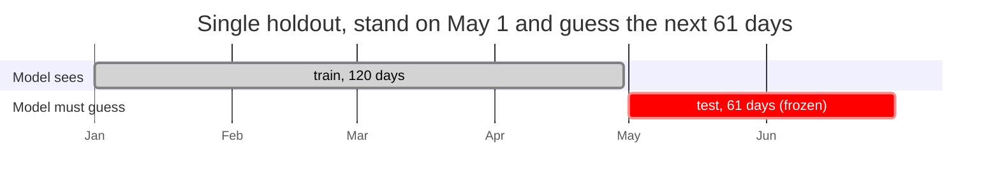
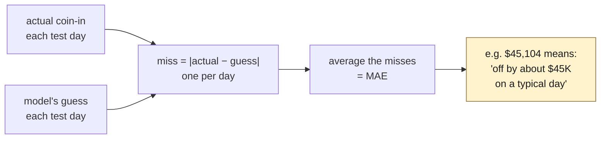
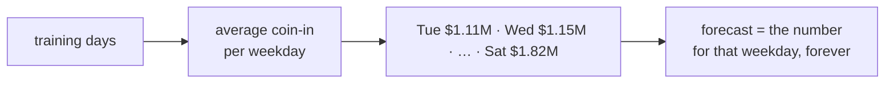
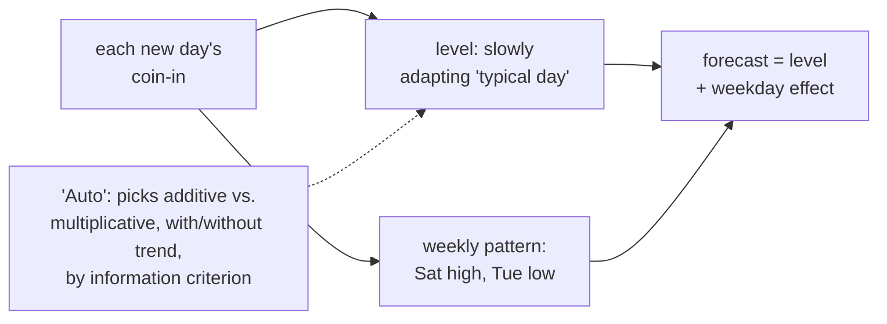
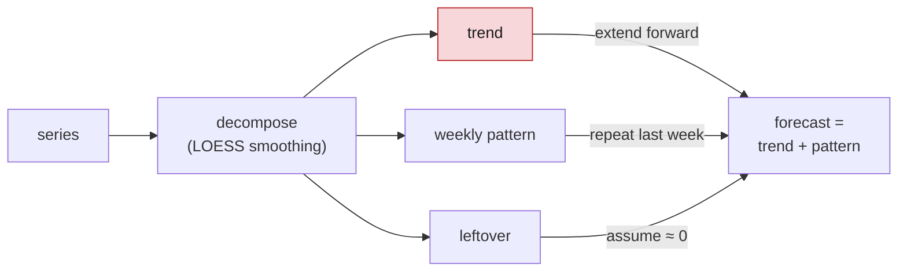
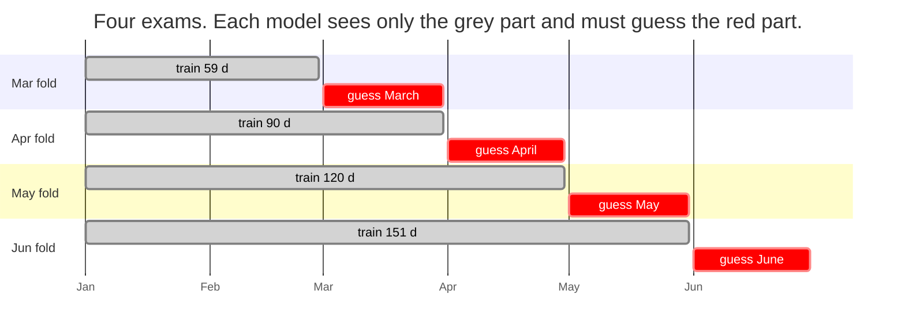
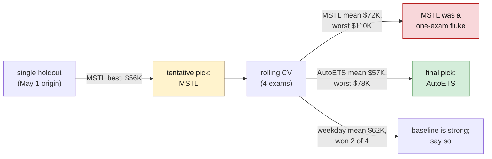

# Forecast Model

What we forecast, how we validated it, what we found, and what the result is for. Decision record: [`DECISIONS.md` D6](DECISIONS.md#d6--forecast-model-autoets-chosen-by-rolling-origin-cross-validation).

## What is forecast

**Daily floor coin-in** (`property_day.coin_in_usd`): total dollars wagered across all machines per gaming day. 181 days, Jan 1 – Jun 30, 2025.

Why this series: it is the floor's demand signal, it drives technician staffing (downtime on a $1.8M Saturday costs far more than on a $1.1M Tuesday), and the guide names it as the beginner-friendly route.

## Validation protocol

Follows GUIDE.md §7 to the letter:

1. **Split by time, never randomly.** Train on days before the origin; test on days after.
2. **Freeze before testing.** Forecast the entire test window at once from the origin; no re-fitting as test days arrive.
3. **Only forecast-time-legal inputs.** Calendar and holidays are known in advance. Events count only if `announced_date < origin` (the Locals Appreciation Week, Jun 9–15, was announced May 26 and is therefore *not* an input for a May 1 forecast). Weather and tourism statistics are published after the fact and are never inputs.
4. **Score with MAE** (mean absolute error, dollars per day): easy to read, in the units of the decision.
5. **Two levels of validation:** a single holdout as the guide suggests, then rolling-origin cross-validation to see whether the ranking is stable.

Every fold asserts `max(train dates) < min(test dates)` in code; this is one of the facts the Lean checker will re-verify from the exported certificate ([`DECISIONS.md` D4](DECISIONS.md#d4--lean-4-core-without-mathlib-as-an-output-checker)).

### The single holdout, as a timeline



The model is handed everything on the left and must produce 61 numbers for the right, all at once, before we look at the answers.

### How one score is computed

Every number in the result tables is a **mean absolute error (MAE)**: the average size of the daily miss, in dollars.



Worked example, AutoETS on the April fold:

```
date      actual         guess          miss
Apr 1     $1,205,000     $1,180,000     $25,000
Apr 2     $1,150,000     $1,210,000     $60,000
Apr 3     $1,310,000     $1,290,000     $20,000
...
Apr 30    $1,420,000     $1,355,000     $65,000
                          average miss = $45,104   ← the number in the table
```

(Illustrative daily rows; the average is the real one.) Lower is better. Because MAE is in dollars per day, it is directly comparable to the stakes of the decision: a $45K typical miss against a $1.3M typical day is about 3.5%.

## Candidates

| model | kind | what it assumes | inputs |
|---|---|---|---|
| constant mean | baseline (guide) | every day looks like the training average | past values |
| weekday mean | baseline (guide's beginner model) | seven fixed numbers, one per weekday | past values |
| SeasonalNaive | classical | next week repeats last week | past values |
| **AutoETS** | classical, statsforecast | exponential smoothing: a slowly adapting level plus a weekly seasonal pattern; the error/trend/season form is chosen automatically by information criterion | past values |
| MSTL | classical, statsforecast | decompose into trend + weekly pattern + remainder (LOESS); extend the trend, repeat the pattern | past values |
| HistGradientBoosting | ML, scikit-learn | trees over weekday, weekend, holiday, count of *known* events, time index | calendar + known events |
| Chronos-Bolt-small | pretrained foundation model, Hugging Face (`amazon/chronos-bolt-small`, 48M params) | zero-shot: pattern-matches the series against what it learned from millions of unrelated series | past values |

All run on CPU in well under a second (Chronos adds ~5 s model load).

### How the two main contenders think

**Weekday mean** keeps seven numbers and never changes its mind:



**AutoETS** (exponential smoothing) keeps a running *level* that drifts as new days arrive, recent days weighing more than old ones, plus a weekly pattern on top:



The difference: if the floor gets busier in spring, AutoETS's level follows it; the weekday mean is still quoting January.

**MSTL** goes further and *extrapolates a trend line*. That is why it won one fold and failed another (see results): with little history, a fitted trend can point the wrong way.



## Results

### Single holdout: origin May 1, 61 test days

Script: `analysis/01_model_comparison.py`

| model | MAE | vs. constant mean | time |
|---|---:|---:|---:|
| MSTL | $56,343 | −74% | 0.13 s |
| AutoETS | $63,316 | −71% | 0.13 s |
| HistGradientBoosting | $68,611 | −69% | 0.57 s |
| weekday mean | $68,699 | −69% | 0.00 s |
| SeasonalNaive | $72,388 | −67% | 0.13 s |
| Chronos-Bolt-small | $77,369 | −65% | 0.43 s + 5 s load |
| constant mean | $218,258 | 0% | 0.00 s |

Taken alone, this says "use MSTL." We did not stop here.

### Rolling-origin cross-validation: four monthly folds

Script: `analysis/02_rolling_cv.py`. One holdout is one exam. Rolling CV gives every model **four separate exams**, standing at the first of March, April, May and June, training only on what came before, and guessing the whole month ahead.



Every model takes the identical four exams with identical scoring, so the rows below are directly comparable.

**How to read the table.** Each cell is one exam's MAE (typical daily miss, in dollars). The two summary columns:

- **mean** = the average of a model's four scores. *"How wrong is it on a typical month?"*
  AutoETS: (78,367 + 45,104 + 58,274 + 45,927) ÷ 4 = 56,918.
- **worst** = the largest of its four scores. *"How badly can it fail?"*
  AutoETS: 78,367 (the March exam).
- **beats weekday mean** = how many of the four exams it scored lower than the weekday mean.

A model with a good mean but a bad worst is dangerous for a 30-day budget decision, because the bad month might be the one you bet on.

| model | Mar (59 d train) | Apr (90 d) | May (120 d) | Jun (151 d) | mean | worst | beats weekday mean |
|---|---:|---:|---:|---:|---:|---:|---:|
| **AutoETS** | 78,367 | 45,104 | 58,274 | 45,927 | **56,918** | **78,367** | 2/4 |
| weekday mean | 72,162 | 40,715 | 61,361 | 73,349 | 61,897 | 73,349 | — |
| Chronos-Bolt | 90,803 | 50,034 | 66,741 | 60,756 | 67,084 | 90,803 | 1/4 |
| MSTL | 110,403 | 46,933 | 54,280 | 74,983 | 71,650 | 110,403 | 1/4 |
| SeasonalNaive | 115,670 | 60,153 | 65,173 | 50,579 | 72,894 | 115,670 | 1/4 |
| constant mean | 223,644 | 203,431 | 233,994 | 202,112 | 215,795 | 233,994 | 0/4 |

Best model per fold: weekday mean (Mar), weekday mean (Apr), MSTL (May), AutoETS (Jun). No model wins everywhere.

(HistGradientBoosting was not included in the rolling run; on the single holdout it tied the weekday mean, which is what a tree model with only calendar features reduces to.)

## What we conclude



1. **AutoETS is the primary model.** Best mean error and best worst-case error; the most stable across folds.
2. **The weekday mean is a strong baseline and we will say so.** It is 8% worse than AutoETS on average and won two of four folds. The guide is explicit that a model does not need to beat the baseline; honest validation earns the credit.
3. **MSTL was a single-holdout mirage.** Its trend extrapolation blew up on the 59-day March fold ($110K, the worst of any real model). We would have shipped it had we stopped at one holdout.
4. **Bigger is not better here.** A 48M-parameter foundation model lost to a weekday average in 3 of 4 folds. With 60–150 training points there is nothing for scale to learn from. Speed vs. size is not a real trade-off for this dataset; everything runs in a fraction of a second.
5. **Four folds is the most this data supports.** Each fold needs enough history to learn a weekly pattern; 181 days gives at most four monthly origins. Stated as a limitation.

## What the forecast is for

The forecast feeds a staffing and promotion decision in the $100K plan: weekday-level demand tells us *when* an added technician shift or a promotion weekend is worth the most. The link from forecast to action is an open design item ([`IDEAS.md`](IDEAS.md)).

## Limitations

- AutoETS sees only the past shape of the series. It cannot anticipate a known future convention; a covariate model could in principle, but the gradient-boosting attempt did not help here.
- Single series, six months: there is no yearly seasonality to learn and no way to validate one.
- Prediction intervals (available from AutoETS via `level=[80, 95]`) are not yet reported; they are required for the uncertainty criterion and are the next step.

## Reproduce

```sh
uv sync
uv run python analysis/01_model_comparison.py   # single holdout, 7 models
uv run python analysis/02_rolling_cv.py          # rolling-origin CV, 4 folds
```

Chronos weights (~190 MB) download from Hugging Face on first run into `~/.cache/huggingface`.
