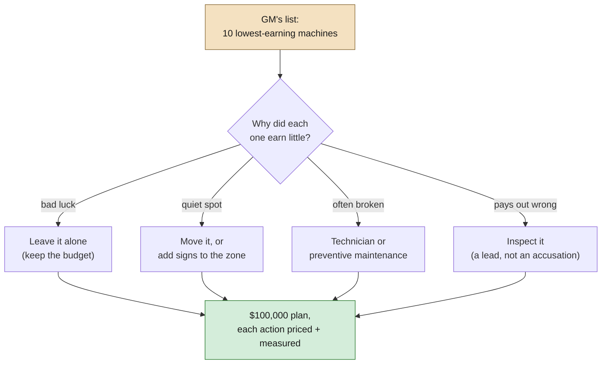
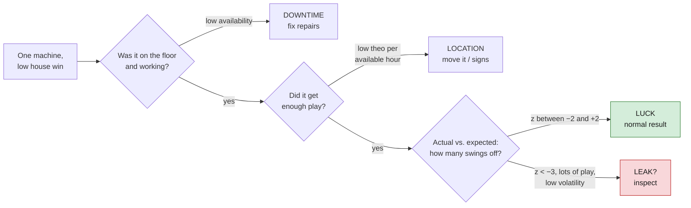
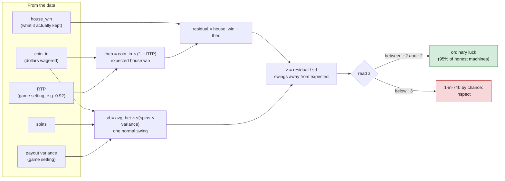
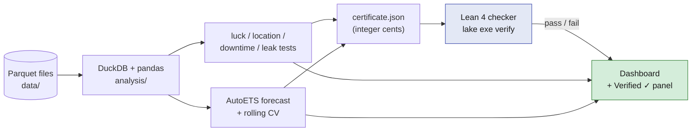
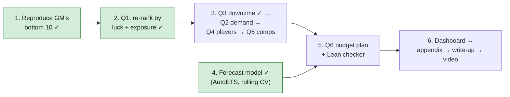

# Project Overview

Our working plan for **Dashboard Royale** (TAMU Datathon). The official rules are in [`../GUIDE.md`](../GUIDE.md); this folder holds *our* thinking.

| Doc | What's in it |
|---|---|
| **OVERVIEW.md** (this file) | The challenge, deliverables, approach, traps, order of work |
| [`DECISIONS.md`](DECISIONS.md) | Every non-obvious choice with its reasoning (fork, DuckDB, architecture, Lean, uv, model) |
| [`Q1.md`](Q1.md) | Which machines are truly weak: the GM's list diagnosed, the Back Forty, M-1158, Ridgeline |
| [`Q3.md`](Q3.md) | Downtime: 0.38% of time, $99K theo, a quarter of it waiting for a tech; why the technician action doesn't pay |
| [`MODEL.md`](MODEL.md) | The forecast: protocol, candidates, results, conclusions, limitations |
| [`IDEAS.md`](IDEAS.md) | Open questions, leads from the data, ideas not yet decided |

## The idea in one paragraph

The GM of The Gilded Ace (a fictional 300-machine casino) wants to replace the 10 machines that earned the least from Jan 1 to Jun 30, 2025. A low-earning machine might be **unlucky, badly placed, often broken, or paying out wrong**, and each cause needs a different fix. We build an interactive dashboard that tests all four explanations, finds the machines that are *truly* weak, and ends with how we'd spend a pretend **$100,000** (or why we'd keep it).

The data is fixed and synthetic. We don't generate data, and there is no answer key: judges grade the **reasoning**, not a hidden "correct" list.



Replacing a machine only helps if the machine itself is the problem. Most of the GM's list, we expect, is not.

## The deliverables

| Piece | What it is | Rubric weight |
|---|---|---:|
| Analysis | Answer Q1–Q6 with fair, exposure- and luck-adjusted comparisons | 30% |
| Dashboard | Public, interactive, a manager can follow question → decision | 25% |
| Model | One forecast vs. a simple baseline on a time-based holdout (train Jan–Apr, test May–Jun) | 20% |
| Recommendations | Up to 3 priced action types, within budget, with a measurement plan | 15% |
| Originality | An unexpected, reproducible finding | 10% |

Also submitted: video (≤ 2 min), write-up (≤ 400 words), all code, AI-use disclosure, Claims & Evidence appendix.

## The six questions

1. **Truly weak machines** once you account for exposure, availability and luck
2. **Demand changes** across the floor, and why
3. **Downtime:** how much play was lost, and when
4. **Player outcomes:** wagered, returned, net, and how concentrated
5. **Comp program:** what it cost, and whether anything changed
6. **$100K plan:** what to fund, and how to know it worked

## How we tell the four causes apart

The diagnostic path, applied to every machine. Each step rules one cause in or out before moving to the next:



| Cause | Signal in the data | Fix |
|---|---|---|
| Luck | Actual house win far below theo, a large negative z-score, high-volatility game | None; keep budget |
| Location | Low theo per available hour, quiet zone / low traffic | Move machine or bank, signs |
| Downtime | Low availability, many fault tickets | Technician, preventive maintenance |
| Leak | Hold consistently below RTP over lots of play, especially low volatility | Inspect (a lead, not an accusation) |

Core formulas:

```
theo            = coin_in × (1 − RTP)
luck residual   = house_win − theo
normal swing   ≈ bet_size × volatility × √(spins)
z               = luck_residual / normal_swing
hold            = SUM(house_win) / SUM(coin_in)      -- ratio of sums, never mean of ratios
```

### The luck test in pictures

A slot machine is a random-number generator. The game's settings tell us two things about it: what it pays back on average (RTP) and how wildly individual payouts swing (variance). From those we can say what a machine *should* have earned and how far from that number pure luck could push it.



Real example from `analysis/00_demo_stats_and_model.py`: machine **M-1035** kept $30,304 against a theo of $30,895, z = −0.2. It earned exactly what the math predicted; it's just lightly played. Machine **M-1158** kept $15,796 against a theo of $51,961, z = −5.2. That is not luck.

## Tech stack (planned)



- **Python 3.12 managed by uv** (`uv sync`, then `uv run python analysis/<script>.py`). Dependencies and their pins live in `pyproject.toml`; `uv.lock` makes the resolution reproducible.
- **DuckDB, pandas, pyarrow** for the analysis. Query Parquet directly; aggregate big tables before loading.
- **statsforecast, scikit-learn, Chronos-Bolt (Hugging Face)** for the forecast and its comparison models.
- **Dashboard tool:** to be decided (see [`IDEAS.md`](IDEAS.md)).
- **Lean 4 (optional checker):** verifies outputs, but doesn't run the analysis. Python exports a JSON certificate (budget plan, ranking, totals in integer cents); Lean checks budget feasibility, action limits and conflicts, sort order, and formula consistency. Lean can't prove statistical claims like "machine X was unlucky."

## Traps to remember

- Drop the 1,018 rows where a machine wasn't on the floor (empty `location_id`)
- Machines move; get location by date from `placements`
- Gaming day runs 6am–6am; March 8 has 23 hours (use `scheduled_seconds`)
- `_cents` vs. `_usd`
- Player tables only cover carded play; compare them with `carded_*` meters
- Aggregate *before* joining (no double-counted money)
- Comp cost is already inside `linked_pos_cogs_usd`
- A missing traffic count means the counter was offline, not zero
- Split the model by time, with no future information

## Judges will try these on the dashboard

1. Change the analysis period
2. Drill into one bank or one guest group
3. Find how the model was validated
4. Trace a recommendation back to its evidence

## Suggested order of work



1. ~~Load the 3 starter files; reproduce the GM's naive bottom 10~~ done
2. ~~Re-rank by luck-adjusted, exposure-adjusted measures (Q1)~~ done: 9 of 10 are a traffic problem in the Back Forty, one machine to inspect ([`Q1.md`](Q1.md))
3. ~~Downtime (Q3)~~ done: small (0.42% of theo), a quarter is waiting for a tech, Ridgeline is a brand problem; technician action doesn't pay ([`Q3.md`](Q3.md)) → demand (Q2) → players (Q4) → comps (Q5)
4. ~~Forecast model + baseline~~ done: AutoETS chosen by rolling CV ([`MODEL.md`](MODEL.md)); prediction intervals still to add
5. Budget plan (Q6) + Lean feasibility check
6. Dashboard → appendix → write-up → video
