# Primer · The knowledge you need to read everything else

Start here if words like *theo*, *hold*, *z-score*, *holdout* or *exposure* are new. Nothing in this file is specific to our findings; it is the background that the findings assume. Read it once, then the Q documents will make sense.

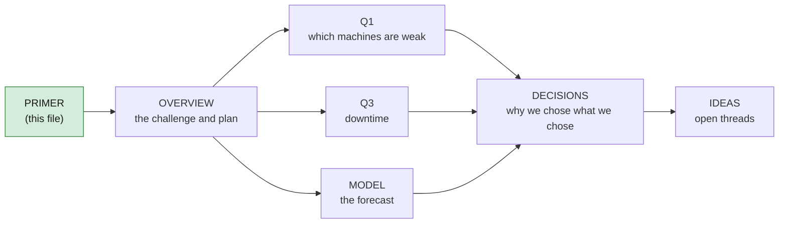

---

## 1. The story in sixty seconds

A fictional casino has 300 slot machines. Its manager wants to replace the 10 that earned the least. We were asked to check whether that's a good idea.

It usually isn't, because a machine can earn little for four very different reasons, and only one of them is the machine's fault:

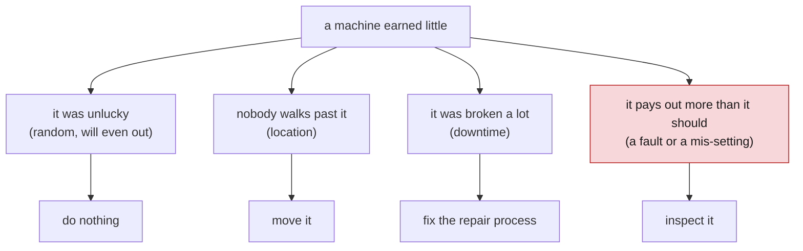

Our job is to work out which reason applies to each machine, then say how to spend a pretend $100,000. The six official questions (Q1–Q6) each probe one piece of that. **Q1** is "which machines are *truly* weak?" **Q3** is "how much did downtime cost, and when?"

---

## 2. How a slot machine makes money

Everything else rests on five words. Here they are with one example: a guest feeds $100 through a machine whose game is set to pay back 92%.

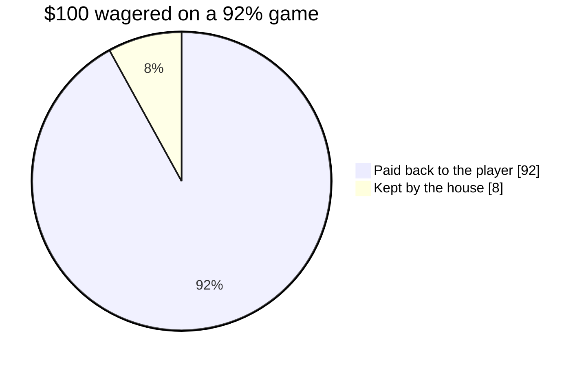

| word | meaning | in the example |
|---|---|---|
| **coin-in** | everything wagered, including winnings that get bet again | $100 |
| **payout** | everything the machine paid back | $92 |
| **house win** | coin-in − payout; what the casino kept | $8 |
| **hold** | house win ÷ coin-in, as a percentage | 8% |
| **RTP** | "return to player": the percentage the game is *designed* to pay back over the long run | 92% |

**Theo** (short for *theoretical win*) is what the house *should* have kept given the RTP: `coin-in × (1 − RTP)`. In the example theo is $8. In real life the house win on any given day is almost never exactly theo, and the gap between them is **luck**.

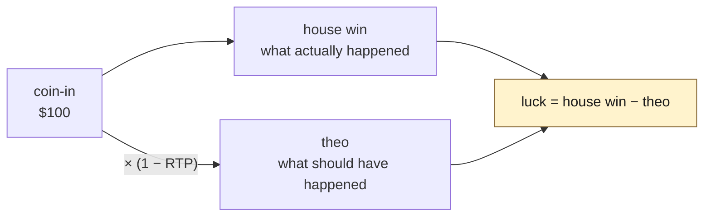

> Why theo matters so much: it lets us separate "this machine is bad" from "this machine had a bad month." A machine with house win far below theo was unlucky *or* faulty. A machine with house win equal to theo but a small theo simply didn't get played.

---

## 3. Luck, and how to tell it from a problem

Slot results are random. Two identical machines, side by side, with identical traffic, will finish a month with different house wins. The question is never "did this machine fall short?" but "**did it fall short by more than luck can explain?**"

### The z-score

Statisticians answer that with a **z-score**: how many "normal swings" a result landed from its expected value.

```
z = (actual − expected) ÷ (size of one normal swing)
```

The "normal swing" (the **standard deviation**, *sd*) is bigger for games with wilder payouts (high **volatility**) and smaller the more spins you have, because luck averages out over many spins.

| z | what it means | how often luck alone does this |
|---:|---|---|
| 0 | exactly as expected | — |
| −1 | one swing below | about 1 in 6 |
| −2 | two swings below | about 1 in 44 |
| −3 | three swings below | about 1 in 740 |
| −4.5 | | about 1 in 300,000 |

With 310 machines, you *expect* about 7 of them to sit below −2 by pure chance, and about 0.4 below −3. If you see many more than that, something other than luck is going on. If you see about that many, the floor is behaving like a fair floor.

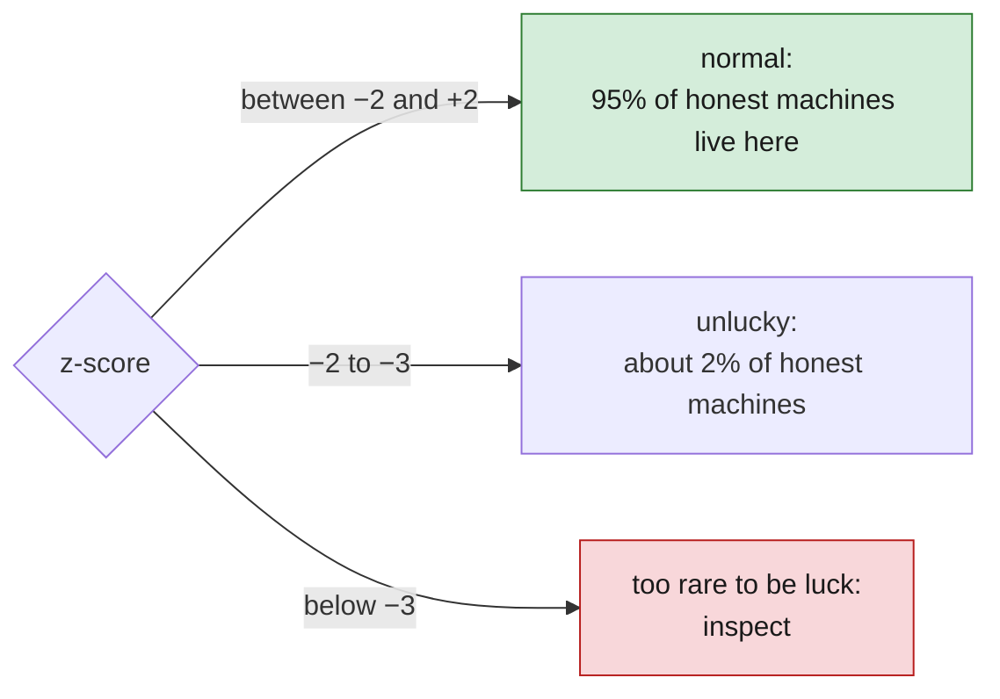

### One catch: the swing has to be measured honestly

If you *underestimate* the size of a normal swing, every z-score looks bigger than it is and ordinary machines look suspicious. Q1 ran into exactly this: a textbook formula understated the swing by about 11%, which made 7 machines look suspicious. Measured against each machine's own day-to-day scatter, only 1 was. ([`Q1.md`](Q1.md#why-we-had-to-fix-the-variance-formula-first), [`DECISIONS.md` D7](DECISIONS.md))

---

## 4. Exposure: comparing machines fairly

Raw totals lie. A machine installed in May cannot have earned as much as one installed in January; a machine that was broken for a week cannot have earned as much as one that wasn't. Before comparing machines you must put them on the same footing.

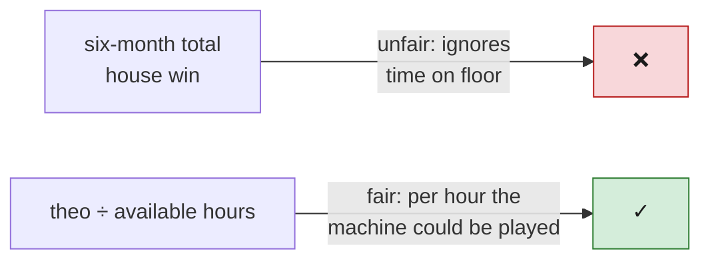

Three ideas:

| idea | definition | why it matters |
|---|---|---|
| **days on floor** | days the machine was installed and not yet retired | 1,018 rows in the data are days a machine *wasn't there*; count them as zero and you'll "find" bad machines that were just absent |
| **availability** | hours the machine was working ÷ hours it was scheduled to be | 99% means it was down ~1% of the time |
| **theo per available hour** | expected win for each hour the machine could actually be played | the fair measure of *demand* for a machine: high = people play it, low = they don't |

**Occupancy** (hours someone was seated ÷ available hours) tells you whether low demand is the machine or the location: a machine that earns normally *while occupied* but is rarely occupied is in a bad spot, not a bad machine.

---

## 5. Q1 in plain words

**Question:** which machines are truly underperforming once you account for exposure, availability and luck?

**Method:** for each of the 310 machines, measure days on floor, availability, theo per available hour, and z-score. Then apply the four-cause logic from section 1.

**What we found** ([`Q1.md`](Q1.md)):

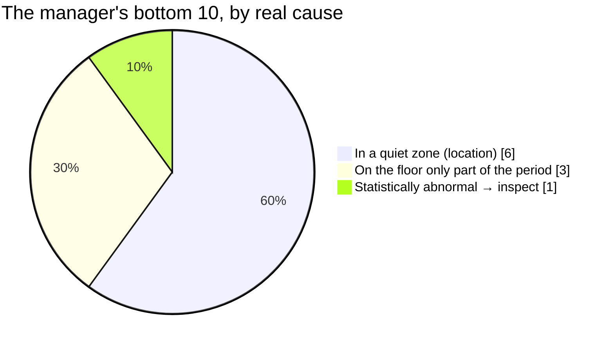

- Nine of the ten are in one zone, the **Back Forty**, which gets a quarter of the foot traffic of the rest of the floor. When somebody *is* sitting at a Back Forty machine, it earns the same per hour as anywhere else. The machines are fine; the spot is empty. (Six of the nine are *only* a location problem; three are also short-tenure.)
- One machine, **M-1158**, keeps 3% of wagers on a game set to keep 10%, every month. Odds of that by luck: about 1 in 300,000. It should be inspected.
- No machine on the list has a downtime problem.

**Why it matters:** replacing a Back Forty machine for $22,000 puts a new machine in the same empty spot.

---

## 6. Downtime vocabulary, then Q3 in plain words

When a machine breaks, a **fault ticket** is opened. Four timestamps on each ticket let us split the outage into three parts:

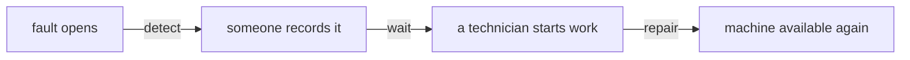

| part | meaning | can money fix it? |
|---|---|---|
| **detect** | time until anyone noticed | monitoring, not staffing |
| **wait** | time until a technician was free | **yes: more technicians** |
| **repair** | time the technician spent fixing it | parts and training, not headcount |

**Lost play** is the wagering that would have happened had the machine been up. We value it in **theo** (what the house would have kept), and we value it **hour by hour**, because an outage at 9 p.m. on Saturday costs more than one at 9 a.m. on Tuesday.

**Question (Q3):** how much play was lost to downtime, and when?

**What we found** ([`Q3.md`](Q3.md)):

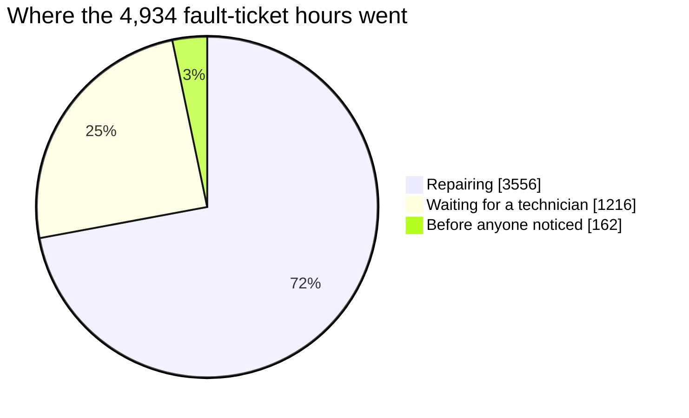

- Machines were down 0.38% of the time, costing about **$99K of theo** in six months, 0.42% of the floor's total. Small.
- A **quarter** of that time was spent waiting for a technician, mostly on the grave shift (one tech) and on weekend day shifts that were scheduled to have a tech and didn't.
- Adding a technician costs $11,520 a month and could recover at most ~$1,900 a month. **It doesn't pay.** Filling the weekend slot that's already on the roster is free.
- One manufacturer, **Ridgeline**, produces 56% of faults, at every machine age. Its cheap service contract is more than wiped out by repair bills.

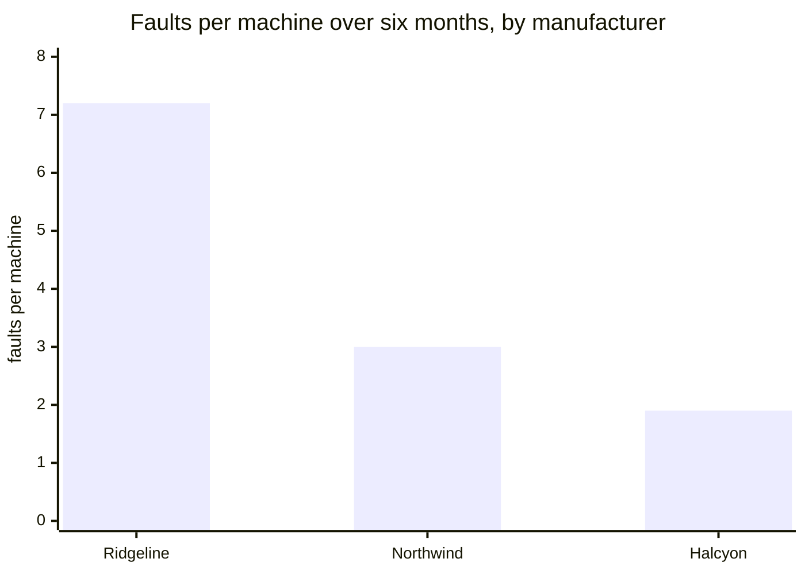

---

## 7. The forecast, in plain words

The challenge also asks for one **model**: a method that predicts something and is tested honestly. We forecast **daily floor coin-in**, the total wagered across all machines each day.

Three ideas carry the whole thing:

**Train / test split by time.** Give the model the past (January–April), make it guess the future (May–June), then compare guesses to what really happened. Never let it see the answers first, and never split randomly, because then it would learn June to predict May.

**MAE** (mean absolute error): the average size of the daily miss, in dollars. "MAE $57K" means "off by about $57,000 on a typical day." Lower is better.

**Rolling cross-validation:** repeat the exam from several different "todays" (March 1, April 1, May 1, June 1) so one lucky month can't crown the wrong model. It did exactly that for us: the model that won the single exam came fourth over four.

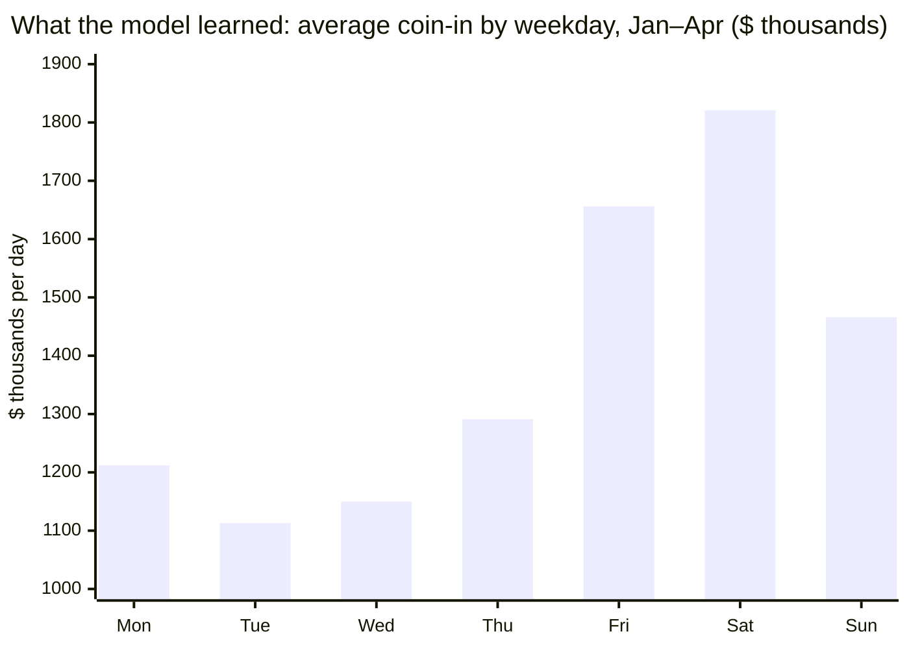

Saturdays bring in 64% more than Tuesdays. That single fact is why downtime on a Saturday night matters more, and why a staffing decision should look at the weekly pattern. Full account: [`MODEL.md`](MODEL.md).

---

## 8. The data, at a glance

Five folders; lower numbers matter more. Three files answer most questions.

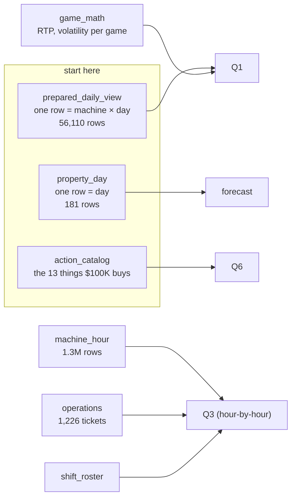

Two conventions that trip everyone:

- **Gaming day runs 6 a.m. to 6 a.m.** A spin at 2 a.m. Saturday belongs to Friday's gaming day. Daily tables already use this; event tables have timestamps you must convert.
- **Cents vs. dollars.** `_cents` columns are integer cents; `_usd` columns are dollars. Mixing them is a 100× error.

Full trap list: [`OVERVIEW.md`](OVERVIEW.md#traps-to-remember).

---

## 9. The tools, one line each

| tool | what it does for us | why this one |
|---|---|---|
| **Python** | the analysis language | the data community's default; every library below is Python |
| **DuckDB** | runs SQL directly on the data files, no database to set up | handles the 1.3M-row table in a second; pandas alone would struggle |
| **pandas** | tables in Python | final shaping and printing of results |
| **uv** | installs the exact same Python packages for everyone | a pip setup drifted and broke within an hour ([`DECISIONS.md` D5](DECISIONS.md)) |
| **statsforecast** | the forecasting models | fast, classical, interpretable |
| **Lean 4** | a proof checker that will verify our budget plan obeys every rule | rules are exact, so a checker beats a promise ([`DECISIONS.md` D4](DECISIONS.md)) |

---

## 10. How to check any number yourself

Every figure in Q1 and Q3 comes from a script you can run:

```sh
uv sync                                          # once: install everything
uv run python analysis/03_machine_diagnosis.py   # Q1, ~5 seconds
uv run python analysis/04_downtime.py            # Q3, ~20 seconds
```

Each writes a CSV to `analysis/output/` with one row per machine (or per ticket). Open it in anything. If a claim in a Q document can't be traced to a row in one of those files, that's a bug and we want to know.

---

## Glossary

| term | meaning |
|---|---|
| **availability** | hours a machine was working ÷ hours it was scheduled to be |
| **bank** | a cluster of machines standing together; zones contain banks |
| **carded play** | play by guests using a loyalty card; the casino can see *who* was playing. Uncarded play is anonymous. Machine meters count both; player tables see only carded |
| **coin-in** | total wagered, including re-bet winnings |
| **comp** | a complimentary (free) drink, meal or credit given to a loyalty-card player |
| **exposure** | how much chance a machine had to earn: time on the floor, hours available, traffic past it |
| **gaming day** | 6 a.m. to 6 a.m.; the casino's accounting day |
| **hold** | house win ÷ coin-in |
| **holdout** | data the model never saw during training, used to test it |
| **house win** | coin-in − payout |
| **luck residual** | house win − theo; positive means the house got lucky |
| **MAE** | mean absolute error; average size of a forecast's daily miss |
| **occupancy** | hours a seat was taken ÷ hours the machine was available |
| **payout** | total paid back to players |
| **RTP** | return to player; the game's designed long-run payback percentage |
| **standard deviation (sd)** | the size of one "normal" swing of a random quantity |
| **theo** | theoretical win; coin-in × (1 − RTP); what the house *should* have kept |
| **theo per available hour** | theo ÷ hours available; our fair measure of demand for a machine |
| **volatility** | how wildly a game's payouts swing; high-volatility games have rarer, bigger wins |
| **z-score** | (actual − expected) ÷ sd; how many normal swings a result is from expectation |
| **zone** | a named area of the floor (Main Entrance, Back Forty, Bar Row, …) |
