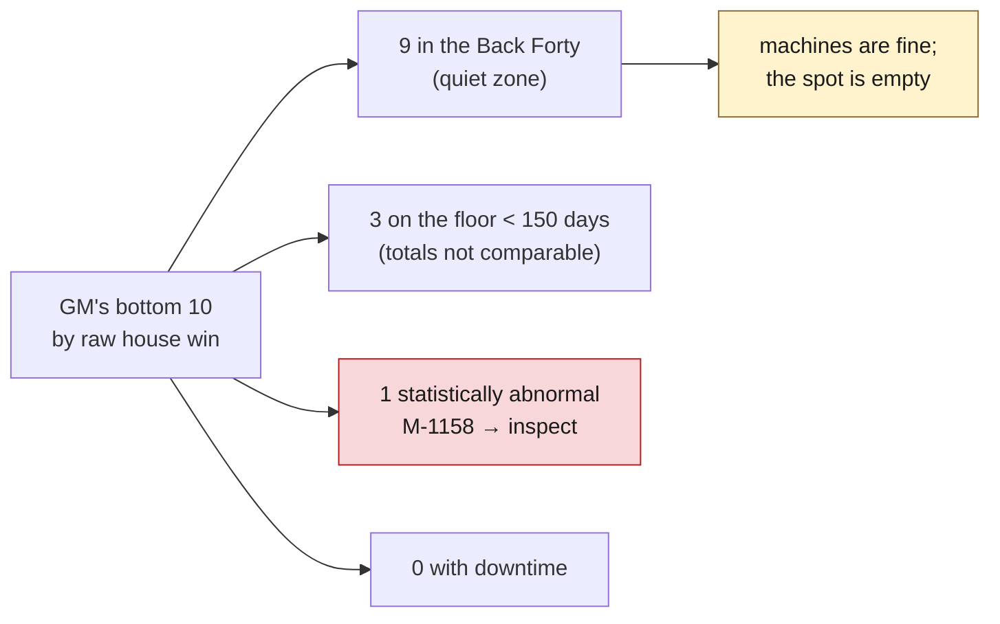
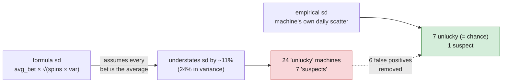

# Q1 · Which machines are truly underperforming?

Script: `analysis/03_machine_diagnosis.py` → `analysis/output/machine_diagnosis.csv` (one row per machine, all metrics below). Method decision: [`DECISIONS.md` D7](DECISIONS.md#d7--luck-z-scores-use-each-machines-observed-variance-not-the-game-math-formula).

## The answer in one paragraph

**The GM's bottom-10 list is a map of the Back Forty, not a list of bad machines.** Nine of the ten sit in zone Z-B40 ("Back Forty"), where foot traffic is a quarter of the rest of the floor. When someone *is* playing them, those machines earn the same per hour as machines anywhere else. Three of the ten were on the floor for only part of the period, so their six-month totals were never comparable. Exactly **one** machine on the list, **M-1158**, shows a shortfall that luck cannot explain, and it should be inspected, not replaced. **None** of the ten has a downtime problem. Meanwhile the floor's real downtime problem (one manufacturer, Ridgeline, with 56% of all faults) does not appear on the GM's list at all.



## How each machine was judged

Every one of the 310 machines was measured over its own days on the floor (the 1,018 not-installed / retired rows are excluded), then passed through the diagnostic path from [`OVERVIEW.md`](OVERVIEW.md#how-we-tell-the-four-causes-apart):

| test | metric | threshold | what it catches |
|---|---|---|---|
| exposure | days on floor | < 170 of 181 | machines whose totals are small because they were not there |
| downtime | available hours ÷ scheduled hours | < 97% | machines that were broken |
| demand | theo per available hour, percentile among all machines | bottom 25% | machines nobody plays (location) |
| luck | z = (house win − theo) ÷ sd | z < −2 unlucky; z < −3 inspect | shortfalls luck cannot explain |

Theo is the *expected* house win given how much was wagered and the game's published payout rate, so "theo per available hour" measures **demand for the machine**, independent of luck and of downtime.

## The GM's list, with verdicts

| machine | game | zone | days | avail. | theo / hr | house win | theo | z | verdict |
|---|---|---|---:|---:|---:|---:|---:|---:|---|
| M-5076 | Royal Draw | Z-B40 | 49 | 99.5% | $6.4 | $3,573 | $7,479 | −0.8 | short tenure; quiet spot; normal luck |
| **M-1158** | Desert Gold | Z-B40 | 181 | 99.9% | $12.0 | $15,796 | $51,961 | **−4.5** | quiet spot; **INSPECT** |
| M-1120 | Royal Draw | Z-B40 | 132 | 99.5% | $6.0 | $16,355 | $18,911 | −0.7 | short tenure; quiet spot; normal luck |
| M-1118 | Platinum Reels | Z-HL | 55 | 99.5% | $19.3 | $20,050 | $25,329 | −0.6 | short tenure; normal luck |
| M-1238 | Royal Draw | Z-B40 | 181 | 99.7% | $7.7 | $24,933 | $33,139 | −1.4 | quiet spot; normal luck |
| M-1181 | Comet Cash | Z-B40 | 181 | 99.8% | $7.5 | $26,977 | $32,516 | −2.3 | quiet spot; unlucky |
| M-1035 | Royal Draw | Z-B40 | 181 | 99.9% | $7.1 | $30,304 | $30,895 | −0.1 | quiet spot; normal luck |
| M-1179 | Comet Cash | Z-B40 | 181 | 99.6% | $7.8 | $30,394 | $33,785 | −1.4 | quiet spot; normal luck |
| M-1017 | Royal Draw | Z-B40 | 181 | 99.8% | $6.8 | $31,940 | $29,526 | +0.8 | quiet spot; normal luck |
| M-1265 | Comet Cash | Z-B40 | 181 | 99.8% | $7.4 | $32,071 | $32,209 | −0.1 | quiet spot; normal luck |

Floor average theo per available hour: **$17.88**. Every Back Forty machine on this list is at $6–8.

Read M-1035 and M-1265: they kept almost exactly what the math predicted (z ≈ 0). There is nothing wrong with them. They earn little because few people walk past.

## Finding 1 · The Back Forty is a traffic problem, not a machine problem

Zone-level view, all 310 machines:

| zone | name | machines | entries / covered hr | occupancy | theo / avail. hr | coin-in / **occupied** hr |
|---|---|---:|---:|---:|---:|---:|
| **Z-B40** | **Back Forty** | 49 | **22.6** | **25%** | **$11.71** | **$482** |
| Z-HL | High-Limit Room | 25 | 6.7 | 6% | $16.64 | $2,738 |
| Z-GAR | Garage Entrance | 36 | 95.4 | 40% | $16.90 | $453 |
| Z-BAR | Bar Row | 49 | 118.2 | 40% | $17.76 | $473 |
| Z-HTL | Hotel Corridor | 37 | 84.3 | 37% | $18.21 | $528 |
| Z-PIT | Center Pit | 80 | 173.1 | 45% | $20.80 | $484 |
| Z-ENT | Main Entrance | 37 | 114.6 | 44% | $21.36 | $523 |

The last column is the key: **once a guest sits down, a Back Forty machine earns $482 per hour, the same as Bar Row ($473) or the Center Pit ($484).** The machines are not the problem. Guests simply don't get there: 22.6 entries per hour against 85–173 everywhere else, and seats occupied 25% of the time against 37–45%. (The High-Limit Room is a different product with few, large bets, and is not comparable on these columns.)

**Size of the gap:** if the Back Forty's 203,548 available machine-hours had earned the floor-average $17.88 instead of $11.71, that is about **$1.26M of theo over six months**. That is an upper bound, not a forecast: moving machines or adding signs redistributes demand rather than creating it, and the budget analysis (Q6) must estimate how much is recoverable. But it says where the money is, and it is not in replacing ten machines.

**Q6 implication:** the catalog's "move a whole bank" ($9,500), "move one machine" ($1,800) and "new signs for a zone" ($7,500) are the actions that address this cause. Replacing a Back Forty machine with a new one ($22,000) puts a new machine in the same empty spot.

## Finding 2 · With honest variance, luck looks like luck, except for one machine

The luck test asks: across 310 machines, how many extreme shortfalls should chance alone produce?

| threshold | expected by chance | observed |
|---|---:|---:|
| z < −2 | 7.1 | **7** |
| z < −2.5 | 1.9 | **1** |
| z < −3 | 0.4 | **1** |

The low tail matches chance almost exactly. The one machine below −3 is **M-1158**:

- Keeps **3.0%** of what is wagered on a game set to keep **10.0%**. It is paying back 97 cents on the dollar.
- Shortfall of **$36,165** against theo over six months, about $72K a year.
- The shortfall is **persistent**, not a single bad week: monthly z of −1.3, −1.4, −2.6, −1.9, −2.4, −1.2. Every month below expected.
- No game-setting change (`configs_seen` = 1), one fault ticket all period (Mar 10), 99.9% availability, so neither a reconfiguration nor downtime explains it.
- It is also in the Back Forty, so its raw total is doubly depressed; the z-score separates the two effects.

Per the rules, this is **a lead to inspect, not an accusation**. The catalog's "inspect a machine and verify its payout" costs $1,200. Against a $36K half-year shortfall, this is the highest-return action available if the inspection finds anything, and cheap insurance if it doesn't.

Two more machines on the GM's list are mildly unlucky (M-1181 at −2.3) or normal. None warrant action on luck grounds.

### Why we had to fix the variance formula first

The first pass used the textbook formula, with the game's published payout variance: `sd = avg_bet × √(spins × variance)`. It flagged **24** machines below −2 (chance predicts 7) and **7** below −2.5 (chance predicts 2). That looked like a floor full of problems.

It was an artifact. Each machine's own day-to-day scatter showed the formula **understates true variance by 24% (median)**. The reason is that bet sizes vary within a day: the formula uses the average bet, but the true variance depends on the sum of *squared* bets, which is always larger when bets differ. The effect is worst on **Royal Draw**, whose bet options span a 20× range (25¢ to $5.00): its formula variance was off by 1.8× to 4.6×, and two Royal Draw machines that looked like leaks (z −3.4, −2.7) are ordinary (z −1.6, −1.6) once measured honestly.



Both z-scores are in the CSV (`z` empirical, `z_formula`). We report the empirical one and show the formula one as the alternative explanation we tested. M-1158 is extreme under both (−4.5 and −5.2).

## Finding 3 · The downtime problem has a name, and it isn't on the GM's list

No machine on the GM's list has availability below 99.5%. Downtime is real on this floor, but it lives elsewhere:

| manufacturer | machines | faults | faults / machine | availability | repair cost |
|---|---:|---:|---:|---:|---:|
| **Ridgeline** | 94 | **680** | **7.2** | 99.32% | **$118,387** |
| Northwind | 101 | 305 | 3.0 | 99.70% | $54,558 |
| Halcyon | 115 | 222 | 1.9 | 99.80% | $40,000 |

Ridgeline is 30% of the machines and **56% of the faults**, with triple the repair spend of Halcyon. All eight lowest-availability machines on the floor are Ridgeline. This is Q3's story and points at a specific catalog action: "preventive maintenance, one manufacturer" ($9,000). Detail to follow in Q3.

## Finding 4 · A lead we did not expect: the *lucky* tail is too fat

| threshold | expected by chance | observed |
|---|---:|---:|
| z > +2.5 | 1.9 | **9** |

Nine machines kept *more* than luck should allow, and the effect is organized by game, not by machine:

| game | machines | mean z | std. error | actual hold | theo hold |
|---|---:|---:|---:|---:|---:|
| Comet Cash | 24 | **−0.72** | 0.20 | 7.7% | 8.0% |
| Lucky Lanterns | 24 | −0.25 | 0.20 | 8.0% | 8.0% |
| … | | | | | |
| Neon Nights | 42 | **+0.32** | 0.15 | 12.1% | 12.0% |
| Platinum Reels | 24 | **+0.54** | 0.20 | 10.6% | 10.0% |

If every game paid exactly its published rate, each row's mean z would sit within about ±2 standard errors of zero. Comet Cash is 3.5 standard errors low (keeping less than published); Platinum Reels is 2.7 high and Neon Nights 2.1 high (keeping more than published). Half a percentage point of hold on Platinum Reels' volume is real money.

We do **not** know why. Possibilities, all testable: the published RTP differs slightly from the configured one; bet-size mix interacts with the pay table; or the data generator planted it. It is logged as a lead ([`IDEAS.md`](IDEAS.md)). It is *not* a claim of wrongdoing, and it argues for a cheap, systematic check (inspect one machine per affected game) rather than for action on any single machine.

## Our bottom 10 (demand-adjusted, full-tenure machines only)

Ranked by theo per available hour among machines on the floor all 181 days:

| machine | game | zone | theo / hr | z | note |
|---|---|---|---:|---:|---|
| M-1017 | Royal Draw | Z-B40 | $6.8 | +0.8 | |
| M-1035 | Royal Draw | Z-B40 | $7.1 | −0.1 | |
| M-1265 | Comet Cash | Z-B40 | $7.4 | −0.1 | |
| M-1181 | Comet Cash | Z-B40 | $7.5 | −2.3 | mildly unlucky |
| M-1238 | Royal Draw | Z-B40 | $7.7 | −1.4 | |
| M-1179 | Comet Cash | Z-B40 | $7.8 | −1.4 | |
| M-1048 | Lucky Lanterns | Z-B40 | $8.5 | +1.1 | |
| M-1162 | Royal Draw | Z-GAR | $8.5 | 0.0 | |
| M-1063 | Comet Cash | Z-B40 | $8.7 | −0.6 | |
| M-1252 | Royal Draw | Z-GAR | $9.2 | +0.8 | |

Eight of ten are Back Forty; six overlap the GM's list. Every one has normal or mildly unlucky results. **This is a list of machines to *move*, not to replace.** Replacement makes sense only where a machine is intrinsically wrong, and the one such candidate (M-1158) should be inspected before anything is decided.

## Claims → evidence

| claim | where the number comes from | alternative we tested | limitation |
|---|---|---|---|
| 9 of GM's 10 are in Z-B40 | `prepared_daily_view`, last `zone_id` per machine | machines move; we also checked `zones_seen` (all 1 for these) | — |
| Back Forty machines earn normally per occupied hour | `coin_in_usd ÷ occupied_hours` by zone | maybe Back Forty has a weak game mix: its mix (Prairie Thunder, Desert Gold, Neon Nights…) is mainstream | occupancy is sensor-derived; see traffic caveats in GUIDE §5 |
| M-1158's shortfall is not luck | empirical z −4.5; formula z −5.2; monthly z all negative | downtime (99.9% available), config change (none), one fault ticket | 1-in-300,000 by chance; still "inspect", never "accuse" |
| unlucky count matches chance | 7 observed vs 7.1 expected at z < −2 | the formula variance, which gave 24 | empirical sd is estimated from ~181 daily points per machine; noisy for short-tenure machines |
| Ridgeline has 56% of faults | `faults_opened` by `manufacturer`, `operations` for cost | maybe Ridgeline machines are older: to check against `install_date` in Q3 | — |
| $1.26M theo gap for the Back Forty | (floor theo/hr − zone theo/hr) × zone available hours | — | upper bound; moving machines redistributes rather than creates demand |

## Reproduce

```sh
uv run python analysis/03_machine_diagnosis.py
```
