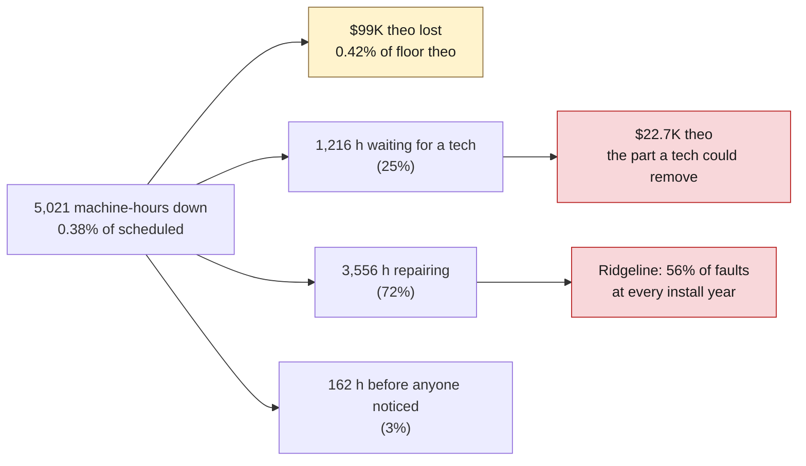
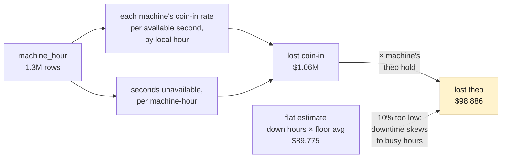
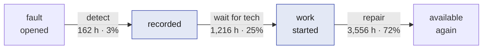
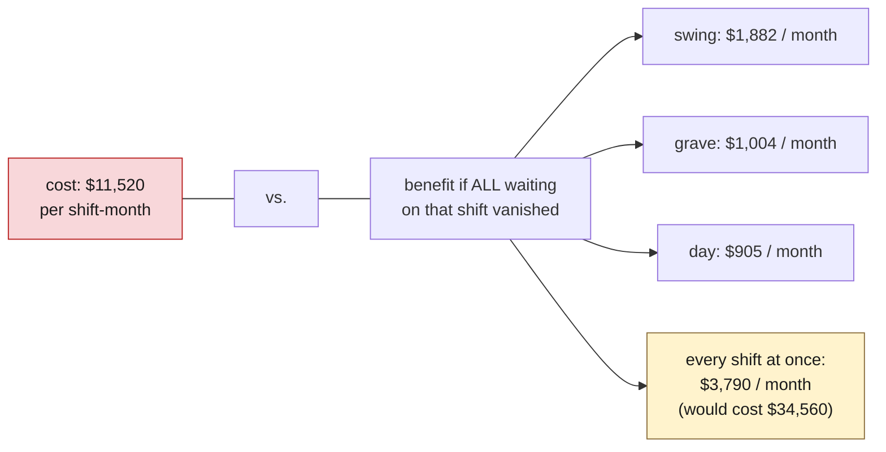

# Q3 · How much play was lost to downtime, and when?

Script: `analysis/04_downtime.py` → `analysis/output/downtime_by_ticket.csv` (1,207 fault tickets with detect / wait / repair hours) and `downtime_by_machine.csv`. Method decision: [`DECISIONS.md` D8](DECISIONS.md#d8--lost-play-is-valued-hour-by-hour-and-reported-as-an-upper-bound).

## The answer in one paragraph

**Downtime is a small problem with a specific shape.** Machines were unavailable for 5,021 machine-hours in six months, **0.38%** of scheduled time, costing about **$99K of theo** (0.42% of the floor's $23.5M). That is real money but not a lever that moves the business, and it is an upper bound (a guest who finds a machine down often just sits at the next one). The shape matters more than the size: **a quarter of all downtime hours are spent waiting for a technician**, waits cluster on the grave shift and on weekend day shifts that were scheduled to have a tech and didn't, and **Ridgeline machines generate 56% of faults at every age**. The catalog's "add a technician" action does **not** pay back on these numbers; "preventive maintenance for Ridgeline" might, but the data cannot say by how much, because the casino has done almost none.



## How lost play was measured

A down hour on a Saturday night costs more than a down hour on a Tuesday morning, so lost play is valued **hour by hour**. For each machine and each local hour of the day, we computed its own coin-in rate per available second from `machine_hour` (1.3M rows). Every unavailable second was multiplied by that machine's rate for that hour, then converted to theo with the machine's theo hold.



The flat estimate (downtime hours × floor-average theo per hour) comes out 10% lower, because outages are more common in the busy evening hours than the average assumes.

**Why theo and not coin-in:** coin-in is wagers, most of which are paid back. Theo is the expected house win on those wagers, the number the casino actually loses.

**Why this is an upper bound:** we assume every lost wager vanished. Some guests walk to the next machine. The floor has plenty of empty seats (the Back Forty runs at 25% occupancy), so substitution is likely material. We cannot measure it from these tables and say so.

## Finding 1 · When: evenings, weekends, and the grave shift

| shift (local) | down hours | lost theo | theo lost per down hour |
|---|---:|---:|---:|
| day (06–14) | 1,212 | $17,985 | $15 |
| **swing (14–22)** | 1,883 | **$51,865** | **$28** |
| grave (22–06) | 1,927 | $29,035 | $15 |

Swing-shift downtime costs almost twice as much per hour because that is when the floor is full. The six most expensive hours to be down are 18:00–23:00 local. Weekends have ~20% more down hours than weekdays. Month to month the picture is flat (June is lowest, see Finding 4).

## Finding 2 · Where the hours go: a quarter is waiting

Every fault ticket has four timestamps. We split the downtime into three parts:



- Detection is fast (median minutes). Not a problem.
- **Repair** is 72% of the hours and takes a median 2.5 h regardless of manufacturer (2.35–2.66 h). No brand is harder to fix; Ridgeline just breaks more often.
- **Waiting** is 25%. Only 36% of tickets wait at all (429 of 1,207), but when they do the median wait is **2.3 hours**, and `work_started_at` lands on shift-start times: the fault sat until the next shift arrived.

| shift fault opened in | tickets | waited | share | wait hours | median wait when waiting |
|---|---:|---:|---:|---:|---:|
| day | 327 | 100 | 31% | 248 | 2.4 h |
| swing | 577 | 175 | 30% | 414 | 1.6 h |
| **grave** | 303 | **154** | **51%** | **554** | 2.9 h |

The grave shift always has exactly one technician. When that tech is on a repair, the next fault waits.

### What waiting cost, in theo

Valued with the same hour-by-hour method, restricted to the waiting window of each ticket:

| shift | tickets that waited | wait hours | theo lost while waiting |
|---|---:|---:|---:|
| swing | 175 | 462 | **$11,294** |
| grave | 154 | 573 | $6,021 |
| day | 100 | 277 | $5,427 |
| **total** | 429 | 1,312 | **$22,741** |

Six months. About **$3,800 a month floor-wide**, and under **$1,900 a month** on the worst shift.

## Finding 3 · The technician action does not pay back

The catalog prices "add one technician to a shift for 30 days" at **$11,520** (8 h × 30 days × $48/h). Set that against what a technician could recover:



Even the best case, a technician on swing who eliminates every minute of waiting, returns about **$1 for every $6 spent** in theo. And the real recovery would be smaller: an added tech removes waiting, not repair time, and some of the "lost" play would have moved to a neighboring machine anyway. **On the data, this action should not be funded.** The guide is explicit that keeping the budget is a valid answer, and for downtime it is the right one.

### The free fix the catalog doesn't list

The roster tells a different story from the catalog. Day shift is **planned** for two technicians on weekdays and one at weekends. On **42 of 181 days** the day shift ran short of its own plan, and on weekends the actual average is **0.77 techs**, meaning roughly one weekend day shift in four had **no technician at all**.

| day-shift tickets | share that waited |
|---|---:|
| opened on a weekday | 13% |
| opened on a **weekend** | **65%** |

Across all shifts, tickets opened during a short-staffed shift waited 59% of the time (mean 2.1 h) against 33% (0.9 h) when the shift was fully staffed. Staffing clearly drives waiting. But the gap is between *planned* and *actual*, so it is a scheduling and attendance problem the casino has already budgeted for, not a case for buying more labor. **Recommendation: fill the weekend day-shift slot that is already on the roster. Cost: $0 of the $100K.**

## Finding 4 · Ridgeline is a brand problem, not an age problem

Q1 found Ridgeline with 56% of faults from 30% of machines. Two alternative explanations needed ruling out.

**Is it age?** No. At every install year, Ridgeline fails two to four times as often:

| install year | Halcyon | Northwind | **Ridgeline** |
|---|---:|---:|---:|
| 2016 | 2.3 | 4.3 | **7.9** |
| 2018 | 2.0 | 3.8 | **8.9** |
| 2020 | 1.7 | 3.6 | **7.6** |
| 2022 | 1.6 | 2.9 | **6.7** |
| 2024 | 1.6 | 3.0 | **5.3** |

(faults per machine over the six months)

**Is it a few lemons?** No. The eight worst repeat offenders (12–16 faults each) are all Ridgeline, but lost theo is spread thin: the top 10 machines account for only 13% of it and the top 30 for 31%. There is no "fix these ten machines" shortcut; it is the fleet.

**The economics.** Ridgeline's service contract is the cheapest on the floor ($4.00 per machine-day against $5–6), and it is a false economy:

| manufacturer | contract / machine-day | repairs / machine-day | **all-in** | lost theo (6 mo) |
|---|---:|---:|---:|---:|
| **Ridgeline** | $4.00 | **$7.03** | **$11.03** | **$54,222** |
| Halcyon | $6.00 | $2.00 | $8.00 | $19,910 |
| Northwind | $5.00 | $2.99 | $7.99 | $24,753 |

Ridgeline costs about **$3 more per machine-day all-in**, roughly **$51K over six months in cash**, plus 55% of the floor's lost theo. The next contract negotiation is the real lever here, and it is outside the $100K.

**A trend worth watching.** Ridgeline's fault rate fell from 4.6 per 100 machine-days in January to 3.4 in June, a 27% drop, while the other brands were flat. Something already changed; we don't know what. Logged in [`IDEAS.md`](IDEAS.md).

### Can preventive maintenance be priced?

The catalog offers "preventive maintenance sweep for one manufacturer" at **$9,000**, 7-day lead, 90 minutes of downtime per machine. For Ridgeline that is 94 machines, ~141 machine-hours of planned downtime (about $2K of theo if done in quiet hours), leaving 23 days of the horizon for benefits.

Ridgeline's exposure over those 23 days is roughly **$16.6K**: ~$9.7K in excess repairs and ~$6.9K in lost theo. A sweep that cut faults by a third for the rest of the month would return ~$5.5K against $11K of cost and planned downtime. **Inside the 30-day horizon it does not pay back; over a longer horizon it might.** The honest problem is that we have **no estimate of the effect size**: the casino performed exactly **3** scheduled maintenance events in six months, so there is no baseline for how much a sweep reduces faults. If funded, it must be funded as a **measured pilot** (sweep half the Ridgeline fleet, compare fault rates against the other half) so that the question is answered. Q6 decides; the numbers are here.

## Claims → evidence

| claim | where the number comes from | alternative tested | limitation |
|---|---|---|---|
| 5,021 h down, 0.38% | `machine_hour.available_seconds` summed where < 3600 | `operations` ticket durations sum to 5,021 h; consistent | — |
| $99K lost theo | per-machine, per-hour coin-in rates × down seconds × theo hold | flat estimate $89.8K | upper bound; substitution unmeasured |
| 25% of downtime is waiting | `work_started_at − recorded_at` summed over tickets | waits could be parts delays, not staffing; but they land on shift boundaries and rise 2× on short-staffed shifts | — |
| tech action returns ~$1 per $6 | $11,520 cost vs. $1,882 best-shift waiting theo per month | counted *all* waiting as recoverable, the most generous case | ignores non-theo benefits (guest experience); none are in the data |
| Ridgeline is brand not age | faults per machine by `install_date` year × manufacturer | age; a few lemons (top-10 = 13% of lost theo) | fault *cause* codes are not in the data |
| Ridgeline costs $3/day more all-in | `service_cost_usd + repair_cost_usd` per active machine-day | — | contract rates from `cost_rules`; repairs from ticket `direct_cost_cents` |
| weekend day shift short-staffed | `shift_roster` `actual_headcount` vs `planned_headcount`, role = slot_tech | — | roster is in the optional folder; we treat it as reliable |

## Reproduce

```sh
uv run python analysis/04_downtime.py
```
